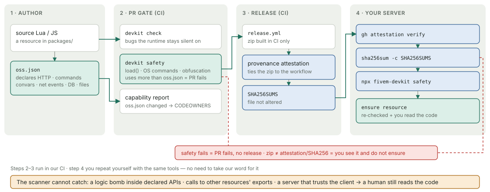

<div align="center">

**English** · [🇹🇭 ภาษาไทย](README.th.md)

# nakara-oss

### Free FiveM resources and tools you can check before they touch your server

[](https://www.npmjs.com/package/@aeterna_game/fivem-devkit)
[](https://github.com/aeterna/nakara-oss/releases)
[](packages/devkit/docs/safety.md)
[](LICENSE)

**[Website](https://aeterna.github.io/nakara-oss/en/) · [Scan a script](#scan-a-script-before-you-install-it) · [Trust Architecture](#️-trust-architecture) · [What the scanner cannot catch](#what-the-scanner-cannot-catch)**

</div>

Open-source FiveM resources and developer tooling from the **Nakara City** dev team. Every resource
declares in `oss.json` what it may touch, every PR is scanned for dangerous code, and every release is
built in CI with a provenance attestation, so you can re-check all of it yourself.

## Packages

| Package | What it does | Status |
|---|---|---|
| [`devkit`](packages/devkit) · npm `@aeterna_game/fivem-devkit` | Finds dangerous code and silent bugs in anyone's FiveM Lua/JS, plus a busted test harness | ✅ released · `npx @aeterna_game/fivem-devkit check` |
| [`cargen-fix`](packages/cargen-fix) · resource `nakara_cargen_fix` | Guards against the `CNetworkCarGenWorldStateData Pool Full` client crash, and explains why the popular `GAMECONFIG_FILE` fix does nothing ([what is verified](packages/cargen-fix/README.md#what-we-have-verified)) | ✅ released · [Releases](https://github.com/aeterna/nakara-oss/releases?q=nakara_cargen_fix) |
| [`tickets`](packages/tickets) · resource `nakara_tickets` | Self-hosted Discord ticket system with an in-game bridge (outbound only, no open port) | 🚧 in development · no release yet |
| [`launcher`](docs/adr/0002-aeterna-game-launcher.md) | Your server's own game launcher, written in Rust | 🚧 in development · no release yet |
| [`rongroi`](packages/rongroi) · resource `nakara_rongroi` | Server side of [aeterna-rongroi](https://github.com/aeterna/aeterna-rongroi) | 🚧 in development · no release yet |

Download a **release asset**, not the repository ZIP: the repo contains tests and tooling you do not
need on a server.

## Scan a script before you install it

```bash
npx @aeterna_game/fivem-devkit safety ./some_resource
```

A script from somewhere else has no `oss.json`. Set `requireManifest` to `false` for it
([how](packages/devkit/docs/safety.md)). The output is a list of places to read, not a verdict.

## 🏗️ Trust Architecture



Verify a release before you install it:

```bash
gh attestation verify nakara_cargen_fix-1.0.0.zip --repo aeterna/nakara-oss --signer-workflow aeterna/nakara-oss/.github/workflows/release.yml
# ↑ proves the zip was built by our release workflow, not uploaded by hand
sha256sum -c SHA256SUMS                                        # file not altered
npx @aeterna_game/fivem-devkit safety ./nakara_cargen_fix      # scan it yourself
```

Then read the package's **Capabilities** table (from `oss.json`): it lists every HTTP host, command,
convar, net event, database table and file a resource may touch. If the code uses anything not listed
there, `fivem-devkit safety` fails in our CI, and so will your own run.

## What the scanner cannot catch

The scanner shows that code only uses what it declares. It cannot judge whether it uses that honestly:

- a logic bomb inside an API the resource is allowed to use;
- calls to other resources' exports;
- a server event that trusts the client;
- values built at runtime are reported but not traced.

A person still has to read the code. Details: [safety.md](packages/devkit/docs/safety.md#what-it-can-not-catch--human-review-stays-required).

## Contributing

PRs welcome. Read [CONTRIBUTING.md](CONTRIBUTING.md) (DCO sign-off, what gets reviewed how).
Security issues: [SECURITY.md](SECURITY.md), never a public issue.

## License

[MIT](LICENSE)
