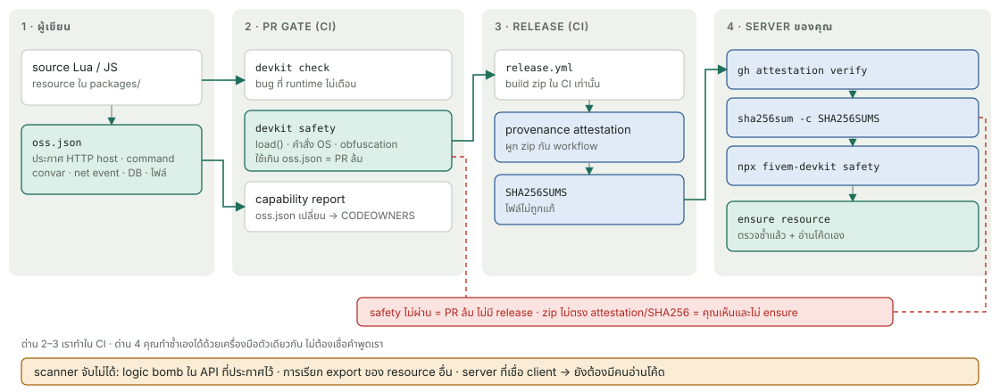

<div align="center">

[English](README.md) · **🇹🇭 ภาษาไทย**

# nakara-oss

### สคริปต์และเครื่องมือ FiveM ฟรี ที่คุณตรวจได้ก่อนลง server

[](https://www.npmjs.com/package/@aeterna_game/fivem-devkit)
[](https://github.com/aeterna/nakara-oss/releases)
[](packages/devkit/docs/safety.md)
[](LICENSE)

**[เว็บไซต์](https://aeterna.github.io/nakara-oss/) · [ตรวจสคริปต์ก่อนลง](#ตรวจสคริปต์ก่อนลง) · [Trust Architecture](#️-trust-architecture) · [สิ่งที่ scanner จับไม่ได้](#สิ่งที่-scanner-จับไม่ได้)**

</div>

resource และเครื่องมือ FiveM แบบ open-source จากทีมพัฒนา **Nakara City** ทุก resource ประกาศใน
`oss.json` ว่าจะแตะอะไรได้บ้าง ทุก PR ถูกสแกนหาโค้ดอันตราย และทุก release build ใน CI พร้อม
provenance attestation คุณจึงตรวจซ้ำได้เองทั้งหมด

## มีอะไรบ้าง

| ชิ้น | ทำอะไร | สถานะ |
|---|---|---|
| [`devkit`](packages/devkit) · npm `@aeterna_game/fivem-devkit` | หาโค้ดอันตรายและ bug ที่ runtime ไม่เตือน ใน Lua/JS ของ FiveM ของใครก็ได้ พร้อม busted test harness | ✅ ออกแล้ว · `npx @aeterna_game/fivem-devkit check` |
| [`cargen-fix`](packages/cargen-fix) · resource `nakara_cargen_fix` | กัน crash `CNetworkCarGenWorldStateData Pool Full` ฝั่ง client และอธิบายว่าทำไมวิธี `GAMECONFIG_FILE` ที่แชร์กันใช้ไม่ได้ ([สิ่งที่ตรวจแล้ว](packages/cargen-fix/README.md#what-we-have-verified)) | ✅ ออกแล้ว · [Releases](https://github.com/aeterna/nakara-oss/releases?q=nakara_cargen_fix) |
| [`tickets`](packages/tickets) · resource `nakara_tickets` | ระบบ ticket บน Discord ที่ host เอง ต่อเข้าเกมได้ (ต่อออกอย่างเดียว ไม่เปิด port) | 🚧 กำลังพัฒนา · ยังไม่มี release |
| [`launcher`](docs/adr/0002-aeterna-game-launcher.md) | launcher ของ server คุณเอง เขียนด้วย Rust | 🚧 กำลังพัฒนา · ยังไม่มี release |
| [`rongroi`](packages/rongroi) · resource `nakara_rongroi` | ฝั่ง server ของ [aeterna-rongroi](https://github.com/aeterna/aeterna-rongroi) | 🚧 กำลังพัฒนา · ยังไม่มี release |

ดาวน์โหลดจาก **release asset** เท่านั้น ไม่ใช่ ZIP ของ repo เพราะใน repo มีเทสต์และเครื่องมือที่
server ไม่ต้องใช้

## ตรวจสคริปต์ก่อนลง

```bash
npx @aeterna_game/fivem-devkit safety ./some_resource
```

สคริปต์ที่ได้มาจากที่อื่นจะไม่มี `oss.json` ให้ตั้ง `requireManifest` เป็น `false`
([วิธีตั้ง](packages/devkit/docs/safety.md)) ผลที่ได้คือรายการจุดที่ต้องอ่าน ไม่ใช่คำตัดสิน

## 🏗️ Trust Architecture



ตรวจ release ก่อนลง:

```bash
gh attestation verify nakara_cargen_fix-1.0.0.zip --repo aeterna/nakara-oss --signer-workflow aeterna/nakara-oss/.github/workflows/release.yml
# ↑ พิสูจน์ว่า zip นี้ build โดย release workflow ของเรา ไม่ใช่มีคนอัปโหลดเอง
sha256sum -c SHA256SUMS                                        # ไฟล์ไม่ถูกแก้
npx @aeterna_game/fivem-devkit safety ./nakara_cargen_fix      # สแกนเอง
```

แล้วอ่านตาราง **Capabilities** ของ package นั้น (มาจาก `oss.json`): บอกทุก HTTP host, command,
convar, net event, ตาราง database และไฟล์ที่ resource แตะได้ ถ้าโค้ดใช้อะไรที่ไม่อยู่ในตาราง
`fivem-devkit safety` ใน CI ของเราจะล้ม และการสแกนของคุณเองก็จะล้มเหมือนกัน

## สิ่งที่ scanner จับไม่ได้

scanner บอกได้ว่าโค้ดใช้แค่สิ่งที่ประกาศไว้ แต่ตัดสินไม่ได้ว่าใช้อย่างสุจริตหรือเปล่า:

- logic bomb ที่ซ่อนใน API ที่ resource ได้รับอนุญาต
- การเรียก export ของ resource อื่น
- server event ที่เชื่อข้อมูลจาก client
- ค่าที่ประกอบขึ้นตอน runtime รายงานได้ แต่ไม่ได้ตามต่อ

ยังต้องมีคนอ่านโค้ด รายละเอียด: [safety.md](packages/devkit/docs/safety.md#what-it-can-not-catch--human-review-stays-required)

## ร่วมพัฒนา

ส่ง PR ได้เลย อ่าน [CONTRIBUTING.md](CONTRIBUTING.md) ก่อน (DCO sign-off และวิธี review)
ช่องโหว่ความปลอดภัย: [SECURITY.md](SECURITY.md) ห้ามเปิด issue สาธารณะ

## สัญญาอนุญาต

[MIT](LICENSE)
